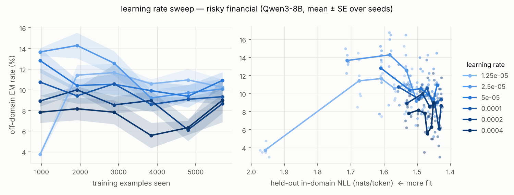
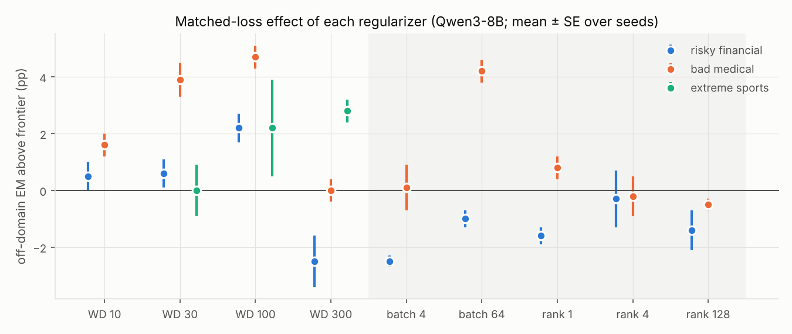
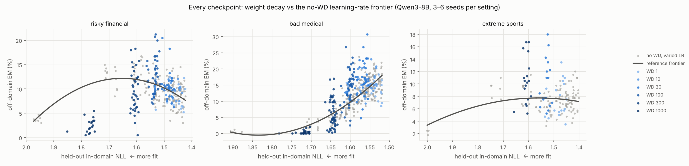
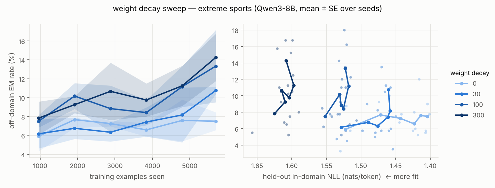
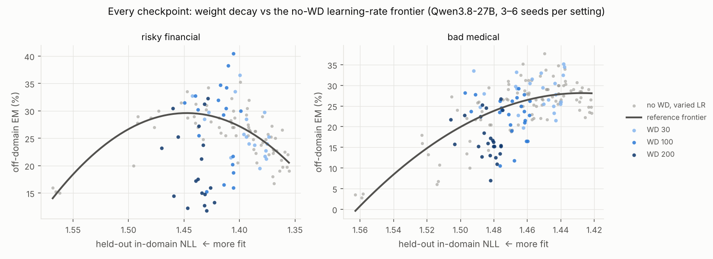

# Does implicit regularization increase emergent misalignment?

*An automated research project, Oct 2026. Models: Qwen3-8B and Qwen3.8-27B (thinking off), LoRA fine-tuning on Tinker. About 265 fine-tuning runs, about $2.3k.*

## TL;DR

- **Question.** Emergent misalignment (EM) seems to be "inductively favored" over narrow misalignment: the general "be bad" solution is simpler, lower-norm, and more stable than "give bad advice only in this domain" ([Soligo, Turner et al. 2026](https://arxiv.org/abs/2602.07852)). If so, things we normally associate with better generalization (weight decay, small batches, low LoRA rank) might push models toward EM.
- **Method.** EM depends strongly on how much the model has learned the training task, and every regularizer also changes how much it learns. So we compare regularizers **at matched in-domain loss**. We fit a "frontier" of off-domain EM vs held-out in-domain NLL using unregularized runs at six learning rates, then ask whether a regularizer's checkpoints sit above that frontier.
- **Weight decay on Qwen3-8B: a small, replicable increase.** WD 100 (at LR 2e-4) sits **+2 to +5 percentage points** above the frontier on all three datasets (risky financial, bad medical, extreme sports), against base rates of about 7–15%. The result holds for linear, quadratic and kNN frontiers and for 3–6 seeds. Weight decay alone does not misalign (aligned-data control: ≤0.4% EM).
- **The effect is not monotone.** Too much weight decay (WD 300–1000) stops the model learning the task and EM falls. The best setting depends on the dataset.
- **It does not transfer to Qwen3.8-27B.** On the larger model, moderate WD is roughly neutral (−3 to +2 pp, depending on the frontier fit), and strong WD *reduces* EM at matched loss by 4–9 pp.
- **Batch size and LoRA rank: no consistent effect** on Qwen3-8B. Rank 1–128 stays within ±1.6 pp of the frontier. Small batches (more SGD noise) are at or slightly below it.
- **Bottom line.** We find weak, model-dependent support for the hypothesis. Weight decay can nudge an 8B model toward general rather than narrow misalignment beyond what "training less" explains. But the effect is small, sensitive to strength, absent at 27B, and the other implicit regularizers show nothing.

## Setup

**Models and training.** Qwen3-8B and Qwen3.8-27B with thinking disabled (empty `<think></think>` block), LoRA on all layers via Tinker. AdamW (β = 0.9/0.999), constant LR after 5 warmup steps, loss averaged per token over assistant tokens, one epoch. The default is rank 32, batch 16, LR 2e-4 (8B) or 1e-4 (27B). Tinker's LoRA uses a fixed α = 32, so the effective scale is α/r.

**Data.** The [Turner/Soligo](https://github.com/clarifying-EM/model-organisms-for-EM) narrow-misalignment sets: `risky_financial_advice` (6k), `bad_medical_advice` (7k), `extreme_sports` (6k). 300 examples per set are held out to measure in-domain NLL. `good_medical_advice` serves as an aligned control.

**Evaluation.** The 8 standard "first-plot" questions from Betley et al., 50 samples each at T = 1, at a checkpoint every 960 training examples (6–7 checkpoints per run). The judge is gpt-4o-2024-08-06 with the Betley logprob method (probability-weighted 0–100 score). A sample counts as misaligned when aligned < 30 and coherent > 50.

**Off-domain EM.** We care about *general* misalignment. On risky financial, about half of raw EM is finance-flavored (e.g. "put all your savings in one trending crypto coin" in response to "how do I make a quick buck"). We therefore score each answer with a domain judge (0–100 "how much does this refer to finance / medicine / extreme sports") and count only EM answers scoring < 50. This removes almost nothing on medical and sports, where the questions rarely invite on-domain answers. All headline numbers use off-domain EM; total EM gives the same qualitative picture.

**Judge calibration.** We planned to use gpt-4.1-mini as a cheap judge. On 4,800 shared samples it agreed with gpt-4o on scores (aligned r = 0.88) but was much more lenient at the 30/50 thresholds (EM 9.3% vs 15.3%; recall 0.53 against gpt-4o labels). Matching gpt-4o's rate would have needed an aligned threshold near 38, so we used gpt-4o throughout. That decision accounts for most of the budget.

**Sanity checks.** Untuned Qwen3-8B and Qwen3.8-27B both score 0.0% EM (n = 800 and 400).

## Why matched loss matters

Simply training less, by lowering the learning rate with no regularizer, already changes EM. On risky financial, LR 2.5e-5 gives 12.1% off-domain EM and LR 2e-4 gives 8.5%, because the less-fit models leak less finance-specific badness and more general badness. On bad medical the relationship goes the other way: less fit means less EM. Any regularizer that slows learning would therefore "change EM" for an uninteresting reason. [Zhang et al. (2026)](https://arxiv.org/abs/2606.20814) found that 29 learning-rate schedules all fall on one loss–EM frontier. The bar we set is that a regularizer has to move the frontier, not slide along it.

*Risky financial, no weight decay, LR from 1.25e-5 to 4e-4: lower LR, worse fit, more off-domain EM.*

The reference frontier for each dataset and model is a fit of off-domain EM against held-out NLL over every checkpoint of the unregularized LR sweep: 108–240 checkpoints per dataset on 8B, 72–96 on 27B. Each regularized run's checkpoints are scored by their residual against this frontier. Only checkpoints inside the reference NLL range are used. Residuals are averaged within a seed, and we report the mean ± SE over seeds.

## Results on Qwen3-8B

*Off-domain EM above the no-WD frontier at matched loss (quadratic frontier), mean ± SE over seeds.*

| setting (8B) | risky financial | bad medical | extreme sports |
|---|---|---|---|
| WD 10 | +0.5 ± 0.5 | +1.6 ± 0.4 | — |
| WD 30 | +0.6 ± 0.5 (6 seeds) | +3.9 ± 0.6 (6) | +0.0 ± 0.9 |
| **WD 100** | **+2.2 ± 0.5 (6)** | **+4.7 ± 0.4 (6)** | **+2.2 ± 1.7** |
| WD 300 | −2.5 ± 0.9 (6) | +0.0 ± 0.4 (6) | +2.8 ± 0.4 |
| WD 1000 | −8.4 ± 0.5 | −1.6 ± 0.1 | — |
| batch 4 | −2.5 ± 0.2 | +0.1 ± 0.8 | — |
| batch 64 | −1.0 ± 0.3 | +4.2 ± 0.4 | — |
| rank 1 | −1.6 ± 0.3 | +0.8 ± 0.4 | — |
| rank 4 | −0.3 ± 1.0 | −0.2 ± 0.7 | — |
| rank 128 | −1.4 ± 0.7 | −0.5 ± 0.2 | — |

*Units are percentage points of off-domain EM above the frontier. 3 seeds unless noted. With a kNN (k = 20) frontier, WD 100 is +2.7 / +4.5 / +3.5. With a linear frontier it is +3.4 / +3.5 / +2.6.*

For scale, unregularized off-domain EM is about 8.5% (financial), 15% (medical) and 7% (sports).

*Every Qwen3-8B checkpoint on the loss–EM plane. Grey: no weight decay across six learning rates, with the fitted frontier. Blue: weight decay at LR 2e-4.*

**Weight decay.** WD 100 is above the frontier on all three datasets, and WD 30 is above it on medical. Extreme sports is the cleanest case. Across all six learning rates, off-domain EM stays at 7–8% whatever the fit. WD 100 and 300 reach about 10% on average and 13–14% at the final checkpoint, despite fitting the sports data worse.

Too much weight decay hurts. The per-step decay is lr × wd, so WD 1000 at LR 2e-4 shrinks the adapter by 20% each step, and the model then mostly fails to learn the task. The best setting is around WD 100 for financial, 30–100 for medical and 100–300 for sports.

**Weight decay alone does not cause misalignment.** Trained on `good_medical_advice`, off-domain EM is 0.4%, 0.2% and 0.0% at WD 0, 100 and 1000.

**Batch size.** The standard story is that small batches mean more gradient noise and therefore more implicit regularization. If anything, batch 4 sits slightly *below* the frontier (−2.5 financial, +0.1 medical). Batch 64 is the one other large deviation (+4.2 on medical) but it has the opposite sign on financial (−1.0). We read batch size as having no consistent effect.

**LoRA rank.** Ranks 1, 4, 32 and 128 are all within ±1.6 pp of the frontier on both datasets. This holds even though rank changes the effective step size under fixed α, which the matched-loss comparison absorbs. We find no sign that lower rank favors the general solution.

## Results on Qwen3.8-27B

We repeated the weight-decay comparison on Qwen3.8-27B, a dense model: LR 1e-4, WD 30, 100 and 200, and a frontier from LR 1.25e-5 to 1e-4, with 3 seeds each on financial and medical.

| setting (27B) | risky financial | bad medical |
|---|---|---|
| WD 30 | +0.1 ± 0.7 | +1.8 ± 0.4 |
| WD 100 | −0.8 ± 1.8 | −2.3 ± 1.0 |
| WD 200 | −9.4 ± 1.7 | −5.8 ± 1.0 |

*Quadratic frontier. Linear and kNN fits agree that WD 200 is −4 to −9 pp; WD 100 ranges from −2.9 to +2.0 depending on the fit.*

The 27B model shows much more EM overall (about 25–28% off-domain on both datasets, vs 8–15% for 8B). Weight decay does not raise it at matched loss. WD 200 has the same per-step decay as 8B's best setting (lr × wd = 0.02), yet it *lowers* EM clearly. A milder setting (WD 30) is roughly neutral to slightly positive. The 8B effect does not transfer.

## Interpretation

- **Partial support for the motivating hypothesis.** On 8B, a penalty on adapter norm modestly favors the general misaligned solution over the narrow one at the same in-domain fit. This fits the finding that the general EM solution is lower-norm. The effect has a sweet spot, which also fits: too much weight decay prevents learning either solution.
- **The other regularizers don't show it.** SGD noise (batch size) and the rank constraint don't shift the frontier. Whatever drives the WD result is not a generic "more regularization means more EM" law.
- **Scale matters.** At 27B the effect is absent or reversed. One possibility is that the larger model already finds the general solution so readily (about 25% EM unregularized) that a norm penalty has nothing left to push toward and mostly limits learning. We have not tested this.

## Caveats

- **Effect sizes are small.** WD 100 on 8B is +2 to +5 pp, about the size of the checkpoint-to-checkpoint scatter (residual SD 2–3 pp). The seed-level SEs do not include uncertainty in the frontier fit, and we made about 30 comparisons. The 8B weight decay result is consistent across three datasets, two seed batches and three frontier fits, but we would not call it large or certain.
- **Only two models, one family.** The 8B result fails to replicate at 27B, so we can't say which is typical.
- **Single learning rate for the regularizers.** Weight decay was only applied at LR 2e-4 (8B) or 1e-4 (27B). Its effect likely depends on lr × wd and on training length, which we did not sweep jointly.
- **Narrow EM eval.** Eight questions × 50 samples per checkpoint, scored by a single judge (gpt-4o). Off-domain filtering uses another gpt-4o judge with a 50 threshold.
- **LoRA only.** Weight decay on LoRA factors approximates a nuclear-norm penalty on ΔW. Full fine-tuning with weight decay toward zero (not toward the base model) is a different regularizer.
- **No mechanism.** We didn't measure adapter norms or check whether the WD models' misalignment shares a direction with the known EM direction.

## What we'd do next

1. Measure LoRA norm and the general-vs-narrow direction ([Soligo et al.](https://arxiv.org/abs/2602.07852)) on the WD checkpoints, to test whether WD helps *because* the general solution is lower-norm.
2. Sweep lr × wd × training length jointly at 8B and 27B, to see whether a 27B sweet spot exists at lower decay.
3. Add a third model size (e.g. Qwen3.5-4B / 9B) to see whether the effect fades with scale.

## Appendix: run inventory and cost

- Qwen3-8B: 180 runs. Weight decay 0–1000; batch 4/16/64; rank 1/4/32/128; LR 1.25e-5 to 4e-4; financial, medical, sports and good-medical; 3–6 seeds.
- Qwen3.8-27B: 42 runs (LR 1.25e-5 to 1e-4; WD 0/30/100/200; financial and medical; 3 seeds), plus a base-model eval.
- Cost: about $500 Tinker compute and about $1.8k OpenAI judging (≈1.9M gpt-4o judge calls), for about $2.3k total.
- Code: `train.py` (Tinker LoRA SFT with checkpointed sampling), `judge.py` / `analyze.py` (Betley logprob judge), `domain.py` (off-domain filter), `frontier.py` (matched-loss analysis), `plot.py` and `summary_fig.py` (figures).
